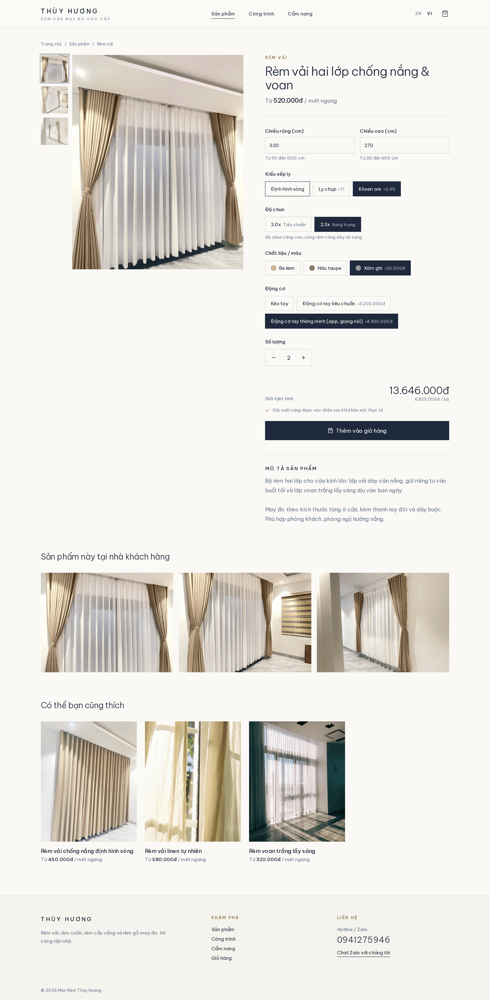
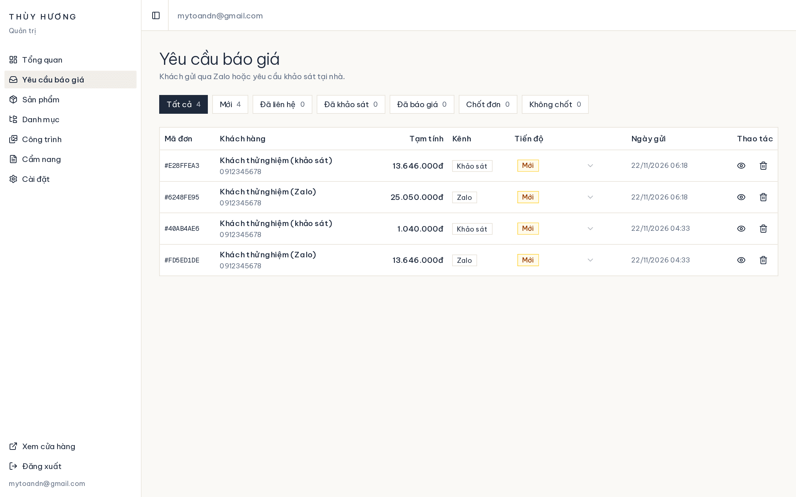
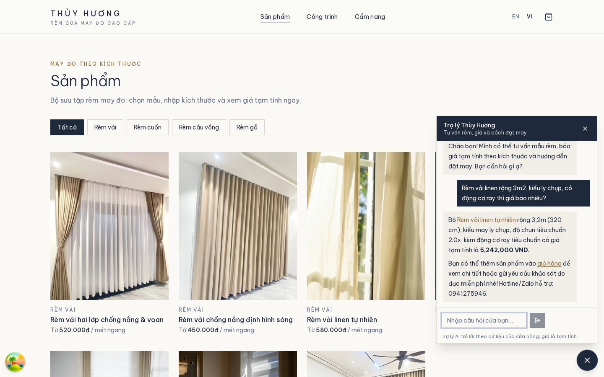

# Màn Rèm Thùy Hương

Website of **Màn Rèm Thùy Hương**, a made-to-measure curtain and blinds shop in Vietnam. Customers pick a curtain,
enter their window size, see an estimated price immediately and send the order through Zalo or ask for a free home
survey. The shop owner runs everything from an admin portal: products, categories, installation photos, guides, the
quote inbox and business settings.

- **Live site:** https://manremthuyhuong.vercel.app (admin at `/admin`)
- **Stack:** Next.js 16, React 19, TypeScript, Tailwind CSS 4, Supabase (Postgres, Auth, Storage), Gemini, Resend
- **Languages:** Vietnamese (default, no URL prefix) and English (`/en`)
- **Design and decisions:** [`docs/spec-curtain-ecommerce.md`](docs/spec-curtain-ecommerce.md)
- **Every screen:** [`docs/screenshots/`](docs/screenshots)

| Home | Product configurator |
| --- | --- |
|  |  |

| Quote inbox (admin) | Chat assistant |
| --- | --- |
|  |  |

## What it does

### Storefront

| Page | Route | What the customer can do |
| --- | --- | --- |
| Home | `/` | Hero, curtain types, featured products, the three-step process, recent installations, guides |
| Catalogue | `/products` | Filter by category, sort by newest / popular / price, 12 products per page |
| Product | `/products/[slug]` | Configure size, pleat style, fullness, fabric and motor; the price updates as they type |
| Cart | `/cart` and the cart drawer | Review the configured items (kept in the browser), then check out |
| Installations | `/lookbook` | Real photos from the shop's Facebook page, filtered by curtain type |
| Guides | `/blog`, `/blog/[slug]` | Articles on measuring windows and choosing curtains |

- **Two pricing models.** Fabric curtains are priced per linear metre (width x fullness x pleat factor), blinds per
  square metre (with a minimum billable area). Options such as fabric colour and motor add a surcharge. A product can
  carry a sale price: the store then shows the sale price, the crossed-out original and the discount percentage.
- **Checkout is a quote request, not a payment.** The customer leaves a name, phone number and address and chooses
  either *Order via Zalo* (opens a Zalo chat with the shop, the order text is copied to the clipboard) or *Request a
  home survey* (the shop is alerted by email). Both are stored in the quote inbox.
- **Chat assistant.** A floating chat on every storefront page answers questions with Gemini, using only the shop's
  own products, prices, categories, guides and Zalo number. Price questions go through the same pricing code as the
  configurator, so the assistant and the product page never disagree. When Gemini is rate limited or busy the
  customer sees a "system is overloaded" toast and can resend the message. Conversations are not stored.

### Admin portal (`/admin`)

| Section | What the owner can do |
| --- | --- |
| Dashboard | New leads, totals and the lead pipeline at a glance |
| Quote inbox | See every request with its items and total, move it through New → Contacted → Surveyed → Quoted → Won / Lost, add notes |
| Products | Create, edit and delete products: photos, price, sale price, pricing model, options, category, active / hidden |
| Categories | Create, rename, reorder and delete. Deleting a category keeps its products (they become uncategorised) |
| Lookbook | Upload installation photos, give them a title, a category and optionally a linked product |
| Guides | Write articles in Markdown with a cover photo, publish or keep as draft |
| Settings | Zalo hotline and the email address that receives survey requests |

Photos are resized in the browser and uploaded to the Supabase Storage bucket (8 MB limit per file).

## How it works

```
Browser ── reads catalogue ──────────────► Supabase (publishable key, row level security)
   │
   ├─ POST /api/quotes ─► recompute prices from the database ─► store lead (service role) ─► email alert (Resend)
   ├─ POST /api/chat   ─► catalogue + guides as context ─► Gemini ─► answer
   └─ /api/admin/*     ─► verify admin session ─► read / write with the service role key
```

- **Prices are never trusted from the browser.** `calculatePrice` in `src/lib/pricing.ts` is the only pricing code.
  The configurator and cart call it in the browser; `POST /api/quotes` calls it again with the prices stored in the
  database before saving a lead, so a tampered request cannot change the total.
- **Public data access.** The storefront reads with the publishable key. Row level security only exposes active
  products, published guides, lookbook photos, categories and public settings. Nothing can be written with that key:
  leads are inserted by the server.
- **Admin access.** `/api/admin/auth/login` signs in with Supabase Auth and keeps the tokens in `httpOnly` cookies. An
  admin is a user whose `app_metadata.role` is `admin`. `src/proxy.ts` redirects anonymous visitors of `/admin/*` to
  the login page and renews expired tokens; the admin layout and every admin Route Handler verify the token again.
- **Popularity.** `products.quote_count` goes up by one each time a product is part of a stored quote request. The
  "Popular" sort uses it.
- **Abuse limits.** Per client address: 5 quote requests per 10 minutes, 20 chat messages per 5 minutes (1,000
  characters each). Both endpoints only accept same-origin requests.

### Database

Migrations are in `supabase/migrations/`.

| Table | Holds |
| --- | --- |
| `categories` | Curtain types, with display order |
| `products` | Name, photos, pricing model, base price, sale price, options, `quote_count` |
| `lookbooks` | Installation photos with title, category and optional linked product |
| `blog_posts` | Guides (Markdown), cover photo, published flag |
| `quote_requests` | Leads: customer details, configured items, server-computed total, status, notes |
| `site_settings` | Zalo hotline and survey email |

## SEO

- **Production URL.** Canonical URLs, hreflang, `sitemap.xml`, `robots.txt`, share images and structured data all use
  `NEXT_PUBLIC_APP_URL`. On Vercel's production deployment it defaults to the project's production domain over
  `https`, and `NEXT_PUBLIC_APP_ENV` to `production`, when they are left unset (`next.config.ts`).
- **Per page.** `buildMetadata()` in `src/lib/seo.ts` builds title, description, canonical, hreflang, Open Graph and
  Twitter tags. Products and guides are shared with their own photo.
- **Catalogue URLs.** Category and page number are part of the canonical URL; the sort order is not.
- **Structured data.** `WebSite` and `HomeGoodsStore` on every page, `Product` (with a per-metre or per-m² offer) and
  `BreadcrumbList` on products, `Article` and `BreadcrumbList` on guides.
- **Sitemap and robots.** `/sitemap.xml` lists the storefront pages, one catalogue URL per category that has products,
  every active product and published guide, in both languages and with their photos. `/robots.txt` disallows `/api`,
  the admin and the cart.
- **Not indexed.** Admin and cart pages are always `noindex`. Outside `NEXT_PUBLIC_APP_ENV=production` (previews,
  local) the whole site is `noindex`.
- **Google Search Console.** Set `NEXT_PUBLIC_GOOGLE_SITE_VERIFICATION` to the token of the "HTML tag" method, then
  submit `/sitemap.xml`.
- **Logo and icons.** The logo is `public/icon.svg`. `pnpm icons:generate` renders `src/app/favicon.ico` and every
  PNG icon from it; `LogoMark` (`src/components/brand/logo.tsx`) draws the same mark in the header, footer, admin and
  share image.

## Getting started

Requirements: Node.js >= 22 (see `.nvmrc`) and pnpm.

```bash
pnpm install
cp .env.example .env.local                       # fill in the values below
supabase db push --db-url "$SUPABASE_DB_URL"     # apply supabase/migrations (once per Supabase project)
pnpm admin:create you@example.com 'a-long-password'
pnpm assets:ingest                               # optional: sample products, fanpage photos and guides
pnpm dev                                         # http://localhost:3000, admin at /admin
```

Without the Supabase variables the storefront still builds and shows empty states.

### Environment variables

| Variable | Required | Purpose |
| --- | --- | --- |
| `NEXT_PUBLIC_SUPABASE_URL` | yes | Supabase project URL |
| `NEXT_PUBLIC_SUPABASE_PUBLISHABLE_KEY` | yes | Public key for catalogue reads (`NEXT_PUBLIC_SUPABASE_ANON_KEY` is accepted as the legacy name) |
| `NEXT_PUBLIC_SUPABASE_STORAGE_BUCKET` | yes | Public bucket for product, lookbook and guide photos |
| `SUPABASE_SERVICE_ROLE_KEY` | yes, secret | Admin reads and writes, uploads, storing leads |
| `GEMINI_API_KEY` | no, secret | Chat assistant. Without it the chat button is hidden |
| `GEMINI_MODEL` | no | Defaults to `gemini-flash-lite-latest` |
| `RESEND_API_KEY` | no, secret | Email alert for survey requests. Without it the alert is skipped |
| `QUOTE_EMAIL_FROM` | no | Sender address, defaults to `onboarding@resend.dev` |
| `NEXT_PUBLIC_APP_URL` | local only | Public origin, no trailing slash. Leave unset on Vercel |
| `NEXT_PUBLIC_APP_ENV` | local only | `development`, `staging` or `production`. Leave unset on Vercel |
| `NEXT_PUBLIC_GOOGLE_SITE_VERIFICATION` | no | Google Search Console token |

`SUPABASE_DB_URL`, `ADMIN_EMAIL` and `ADMIN_PASSWORD` are only read by the scripts, never by the app.

### Scripts

| Script | Purpose |
| --- | --- |
| `pnpm dev` / `build` / `start` | Develop, build, serve |
| `pnpm lint` / `lint:fix` | Biome lint |
| `pnpm format:check` / `format:fix` | Biome format |
| `pnpm type-check` | `next typegen` + `tsc --noEmit` |
| `pnpm test` / `test:coverage` | Vitest |
| `pnpm check` | lint + type-check + test |
| `pnpm admin:create <email> <password>` | Create an admin or reset its password |
| `pnpm assets:ingest` | Upload photos and seed products, lookbook and guides (`--dry-run`, `--force`) |
| `pnpm icons:generate` | Regenerate the favicon and app icons from `public/icon.svg` |
| `pnpm screenshots` | Playwright captures into `docs/screenshots/` (`--submit` sends two test leads) |

A change is done when `pnpm lint`, `pnpm format:check`, `pnpm type-check`, `pnpm test` and `pnpm build` pass.

## Deployment

### Vercel

1. Import the repository and add the environment variables from the table above to the **Production** environment.
   Do not copy `NEXT_PUBLIC_APP_URL` or `NEXT_PUBLIC_APP_ENV` from `.env.local`: on Vercel they are derived from the
   production domain. If you do set `NEXT_PUBLIC_APP_URL`, it must start with `https://`.
2. `NEXT_PUBLIC_*` values are read at build time, so redeploy after changing them. Server secrets such as
   `GEMINI_API_KEY` are read at runtime.
3. Check `https://<domain>/robots.txt`: it should end with `Sitemap: https://<domain>/sitemap.xml`. A "Disallow: /"
   answer means the deployment is not running as production.

### Docker

```bash
docker compose up --build   # app + nginx on http://localhost:8080
```

`NEXT_PUBLIC_*` values are build args and the server secrets are passed at runtime (see `docker-compose.yml`).

## Project structure

```
src/
  app/
    [locale]/              (store)/ storefront pages, admin/(auth)/login, admin/(portal)/ admin pages
    api/                   Route Handlers: quotes, chat, admin/* (session required), health
    sitemap.ts  robots.ts  manifest.ts  opengraph-image/  twitter-image/  favicon.ico
  proxy.ts                 next-intl + /admin session guard and token renewal (Next.js 16 name for middleware)
  api/<domain>/            client-side requests, queries, mutations, types, schemas (catalog, quotes, chat, admin-*)
  modules/<page>/          page-level UI: index.tsx, components/, hooks, __tests__/
  components/
    ui/                    shadcn/ui primitives (do not hand-edit, wrap them in common/)
    store/  admin/  brand/ storefront pieces (cart, checkout, chat), admin pieces (upload, states), the logo
    common/  form-field/  seo/  providers/  utilities/
  lib/                     pricing, product-listing, seo, zalo, quote, format
    supabase/              public and service-role clients
    server/                admin session, storage, email, rate limit, Gemini, chat assistant
  messages/                en/*.json, vi/*.json (key parity is checked at compile time)
  i18n/  hooks/  stores/  constants/  config/  types/  styles/
scripts/                   create-admin, ingest-curtain-assets, generate-icons, capture-screenshots
supabase/migrations/       schema, row level security, seed categories and settings
docs/                      spec and screenshots
```

Conventions (full list in [`AGENTS.md`](AGENTS.md)):

- **Thin pages, fat modules.** `app/**/page.tsx` only composes a module from `src/modules`.
- **One folder per API domain** under `src/api`. Components use that domain's `queries` / `mutations`, never axios
  directly, and the browser only talks to this app's own Route Handlers.
- **i18n.** No hardcoded user-facing strings. Use `useTranslations` from `@/hooks` (client) or
  `@/hooks/use-translations-server` (server), add every key to both locales, and take navigation helpers from
  `@/i18n/navigation`.
- **Env.** Read environment variables only through `src/constants/env.ts` and `src/constants/env.server.ts`.
- **Naming.** Files and folders are `kebab-case`.
- **Commits.** Conventional commits (`feat`, `fix`, `docs`, ...), lowercase imperative subject, enforced by commitlint.

## Customising

- **Hotline and survey email:** `/admin/settings`, not environment variables.
- **Shop name, tagline, Facebook page, theme colour:** `src/config/site.ts`.
- **Page titles and descriptions:** the `seo` keys in `src/messages/vi/common.json` and `src/messages/en/common.json`.
- **Chat assistant wording and limits:** `src/lib/server/chat-assistant.ts` and `src/app/api/chat/route.ts`.
- **Colours and fonts:** the `@theme inline` block in `src/styles/globals.css`.
- **Email alerts:** until a domain is verified in Resend, it only delivers to the Resend account owner's address and
  the sender must stay `onboarding@resend.dev`.

## Known limits

- The seven products and three guides created by `pnpm assets:ingest` are sample data with stock photos and made-up
  prices. Replace them in the admin before taking real orders.
- There is no online payment: every order is a lead that the shop follows up by Zalo or phone.
- Rate limits are kept in memory per server instance, so on serverless hosting they are approximate.
